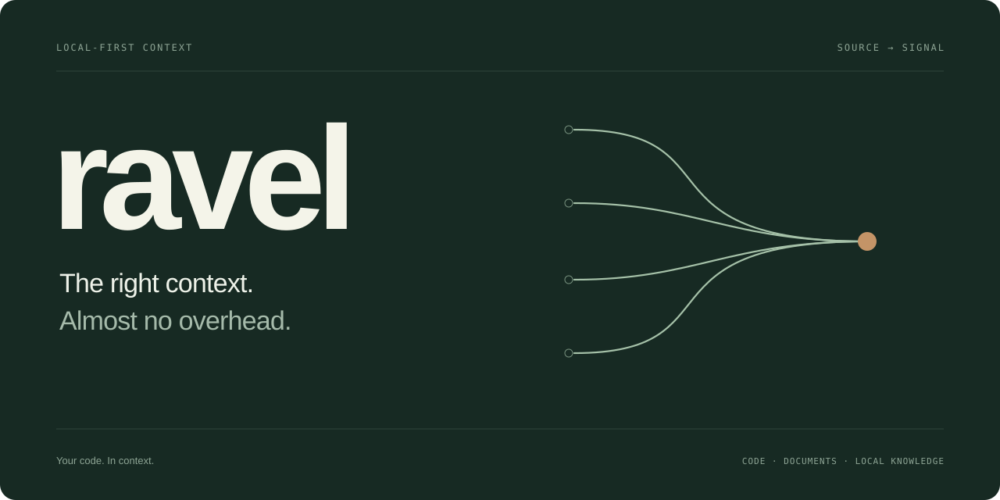
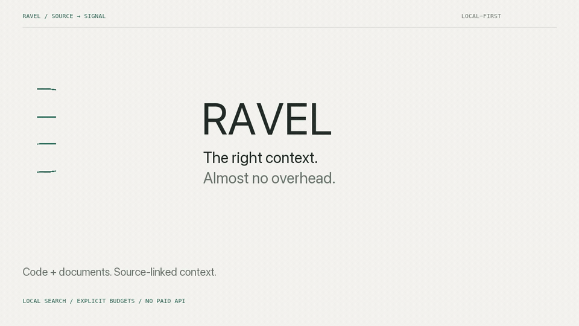
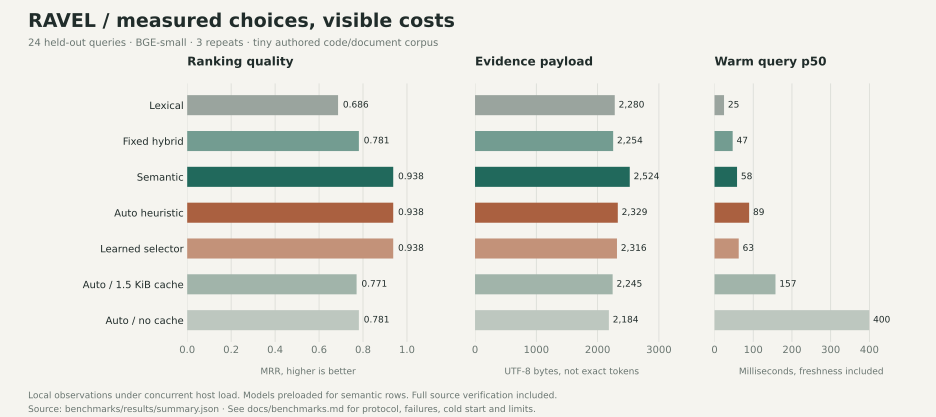

<p align="center"></p>

<p align="center">
  <a href="https://github.com/nazeeh111/RavelIndex/actions/workflows/ci.yml"></a>
  <a href="https://github.com/nazeeh111/RavelIndex/releases"></a>
  <a href="LICENSE"></a>
  
</p>

**Find the function, passage or note you need. Give your coding agent the evidence that fits.**

[](docs/assets/demo.mp4)

<sub>18-second silent montage of genuine local UI captures, not a real-time recording.
The semantic capture includes a 5.2-second first model load. [Video, editable source and provenance](docs/demo/README.md).</sub>

RAVEL is a compact local context engine for code repositories, Markdown, text and
optional PDF/DOCX documents. Exact identifiers use SQLite BM25 without loading an
embedding model. Harder questions can use local semantic retrieval. A cost-aware
planner decides how much work to do, while a bounded int8 vector cache trades
storage for recomputation.

No accounts, paid APIs, telemetry or always-running daemon. One small core dependency.
The optional model stays on your machine. **v0.1.0 is an experimental alpha**, with
measured strengths, failures and limits documented below.


## Search in a minute

Python 3.10+ and Git are required for this installation route. [uv](https://docs.astral.sh/uv/)
is optional; ordinary pip works too.

```sh
uv tool install 'ravel-index @ git+https://github.com/nazeeh111/RavelIndex@v0.1.0'

ravel index /path/to/your/repository
ravel search 'retry_with_backoff' --root /path/to/your/repository --tokens 2048
ravel inspect --root /path/to/your/repository
```

Prefer pip? Install the [release wheel](https://github.com/nazeeh111/RavelIndex/releases/download/v0.1.0/ravel_index-0.1.0-py3-none-any.whl)
in your virtual environment:

```sh
python -m pip install https://github.com/nazeeh111/RavelIndex/releases/download/v0.1.0/ravel_index-0.1.0-py3-none-any.whl
```

Try a public sample with no personal-data indexing:

```sh
git clone https://github.com/nazeeh111/RavelIndex.git
cd RavelIndex
ravel index examples/sample
ravel search 'retry_with_backoff' --root examples/sample --tokens 2048
ravel symbols ExpiringCache --root examples/sample
```

Search returns source paths and exact line spans, a SHA-256 source hash, the current
Git revision when available, and actual retrieval evidence. Editing, deleting,
renaming or ignoring a file refreshes the next default search automatically.
Source files are never changed by RAVEL.

## Add local semantic search

The core needs no model. Semantic support is an explicit extra and a separate,
one-time public model download, approximately **67.2 MB** excluding the runtime.

```sh
python -m pip install 'ravel-index[semantic] @ git+https://github.com/nazeeh111/RavelIndex@v0.1.0'
ravel index examples/sample --semantic --download-model --materialize
ravel search 'How can I wait longer between temporary failures?' \
  --root examples/sample --tokens 2400
```

The pinned BGE-small model runs locally through ONNX on CPU. Later queries use
local model files only. `--materialize` precomputes vectors up to the saved cache
quota; omit it for lazy computation. `--cache-mb 1` sets a persistent vector payload
quota. Models, metadata, source text, SQLite pages and process memory are separate
costs. Inspect them with `ravel stats --root examples/sample`.

## Put RAVEL in your coding agent

```sh
codex mcp add ravel -- ravel mcp --root /absolute/path/to/repository
claude mcp add --transport stdio ravel -- ravel mcp --root /absolute/path/to/repository
```

Ask your agent to use `ravel_search` to find the relevant implementation and cite
its source lines. The server fixes one approved root and exposes search/status,
with no source-editing or network tool. [Configuration, Python API and verification](docs/integrations.md).

```python
from ravel import Index

with Index("/path/to/repository") as index:
    answer = index.search("retry_with_backoff", token_budget=2048)
    for hit in answer["results"]:
        print(hit["path"], hit["start_line"], hit["end_line"], hit["text"])
```

## Spend context deliberately

```sh
ravel search 'ExpiringCache.get' --root examples/sample --mode lexical --json
ravel search 'expire old entries' --root examples/sample \
  --latency-ms 300 --memory-kib 1024 --tokens 1800 --json
```

The planner selects lexical search, semantic reranking or compressed-vector
scanning from query shape, lexical evidence, cache coverage and observed cost.
It preserves lexical candidates when a cold semantic scan would be incomplete.
The cache prioritizes vectors by access frequency and measured regeneration cost
per byte. A small learned selector is included for reproducible experiments and
explicit opt-in, rather than silently learning from private queries.

`--tokens` conservatively charges serialized evidence **UTF-8 bytes as a token
upper bound**. It is not an exact model tokenizer count. Provenance counts toward
that budget; protocol/metrics overhead is separate. `--latency-ms` is a soft target
and `--memory-kib` is a candidate-work allowance, not a total-process memory cap.

The [interactive inspector](docs/inspector.md) shows the actual selected strategy,
source evidence, cache hits, index storage and elapsed time. No external UI assets,
JavaScript framework or hosted service is required.

## Measurements, including where RAVEL loses

The repository includes raw runs and reproducible harnesses for:

* A separately authored 48-query code/document experiment with subject-disjoint
  training and held-out test queries, heuristic versus learned routing, cache
  quotas, fixed-strategy ablations, source freshness, CPU time and peak memory.
* A shared 32-file/32-query fixture run with **LEANN, QMD, Codanna, grepai, exact
  FAISS and RAVEL**, including a model-matched MiniLM cohort.
* One full-repository **ContextBench** diagnostic, with the original issue as the
  query and gold paths used only for scoring. This exposed a cold-routing failure
  and motivated the lexical-preserving fallback.



These are small, local experiments, not leaderboard results. Several competitors
score perfectly on the shared fixture. **LEANN and FAISS have smaller indexes than
RAVEL there.** A smaller RAVEL cache can be slower and less accurate. The learned
policy did not establish an advantage and is not the default. CLI startup, warm
API calls, embedding models and tool capabilities are disclosed separately.
Concurrent local workloads limit latency comparisons.

[Full methodology and held-out results](docs/benchmarks.md) ·
[Head-to-head configurations and results](docs/comparison.md) ·
[Raw measurements](benchmarks) · [Current-source research and prior art](docs/research.md)

Adaptive routing, BM25, AST chunking, incremental indexing and MCP already exist
in other tools. RAVEL's experimental contribution is a minimal, inspectable joint
policy for retrieval depth, context allowance and frequency/cost-aware vector
retention. It is not a claim to have invented those individual techniques.

## Freshness and privacy are part of retrieval

Default searches hash eligible source bytes, so same-size edits with preserved
modification times are detected. SQLite transactions prevent concurrent indexing
from mixing source text, hashes and vectors. Removed, denied or newly ignored
files lose old entries. This costs O(source bytes) per search. `--snapshot` is a
consciously unchecked mode, labeled in every returned evidence object.

RAVEL honors hierarchical Git ignores and `.ravelignore`, skips hidden directories,
symlinks, common secret names/patterns, unreadable files and files over 2 MiB.
Exclusions are best effort; keep sensitive material outside the approved root or
explicitly exclude it. The index contains readable source excerpts and is not
encrypted. [Privacy boundaries](docs/privacy.md).

## Limits worth knowing

* Full source verification and a cold model load can exceed the latency target.
* Vector search uses a streaming linear scan, not an ANN index. Cold lazy scans
  may be partial; hybrid reranks lexical candidates rather than recovering all
  lexical misses. Large-corpus quality and scale are not established.
* Python has AST symbols and call observations. Other languages currently have
  line chunks, not resolved symbol graphs. PDF/DOCX locations are extracted-text
  lines; image-only PDFs need external OCR. Install `.[documents]` for these parsers.
* The public diagnostic is one task. Full ContextBench/Agent Retrieval Bench and
  end-to-end coding-agent success rates have not been replicated. Claude Code
  configuration follows its documentation; no installed Claude client was available.

## Build and contribute

```sh
python -m pip install -e '.[dev,documents]'
python -m pytest -q
ruff check src tests
python -m build
```

[Architecture](docs/architecture.md) · [Contributing](CONTRIBUTING.md) ·
[Independent review](docs/review.md) · [Licenses and attribution](docs/attribution.md)

MIT licensed.
