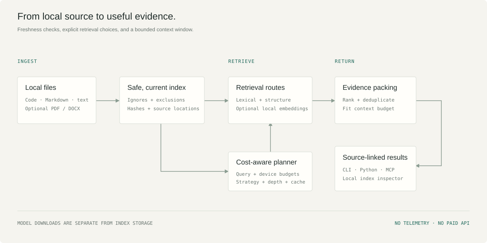

# How RAVEL retrieves context

RAVEL is a Python library, CLI and local MCP server. SQLite owns persistence and
FTS5 owns BM25 ranking. There is one source root per database, normally
`.ravel/index.sqlite3`. No external database service is needed.

## Evidence and freshness

A default search discovers eligible files and hashes their bytes before retrieval.
Unchanged hashes preserve chunk and vector IDs. Edits replace a file's chunks;
deletes, renames, ignored files and permission loss remove its old chunks and
cached vectors through foreign-key cascades. A branch switch changes the current
revision and source bytes on the next search. Rename detection does not preserve
vectors: correctness takes precedence over avoiding recomputation.

A database write transaction serializes scan/retrieval/materialization with
concurrent writers so returned text, hashes and cached vectors cannot mix source
generations. This is a database snapshot, not a filesystem lock.

This scan is O(source bytes), and its time is included in `elapsed_ms`. That is a
real cost on large roots. `--snapshot` explicitly skips it and marks evidence
unchecked. RAVEL does not claim a file watcher, an atomic filesystem snapshot or
zero-cost freshness. Concurrent writes can occur after a scan. SHA-256 identifies
the actual indexed bytes even when a Git revision also exists; a revision alone
never proves an uncommitted file matches its commit.

Python files use the built-in AST for decorated classes/functions and observed
call expressions. Other code is line-chunked. Calls are syntactic observations,
not resolved cross-language dependency edges. PDF and DOCX lines refer to extracted
text, clearly identified by `line_basis`, rather than PDF page coordinates or
Word's visual layout. Scanned/image PDFs require external OCR and produce no
invented text.

## Retrieval strategies

* **Lexical:** tokenize identifiers and camelCase for FTS5 BM25. Weight paths and
  symbols, boost exact symbol/file matches and support quoted phrases.
* **Hybrid:** rerank a bounded lexical candidate set with local embeddings and
  reciprocal rank fusion. It cannot recover a source that lexical search missed.
* **Semantic:** stream cached int8 vectors, keeping only a bounded heap of best
  results. Spend remaining time on a query-seeded, stratified sample of uncached
  chunks. Complete materialization plus sufficient time gives exhaustive cached
  cosine search; partial coverage is reported, never presented as exhaustive ANN.

BGE-small-en-v1.5 runs through FastEmbed/ONNX on CPU with two threads. Query
instructions follow BGE's retrieval format. Each vector is symmetrically quantized
to signed 8-bit components with a stored norm, then compared by cosine. No neural
model is trained by RAVEL. Model download is a separate, explicit opt-in;
subsequent queries request local files only.

## Joint cost policy

The deterministic planner observes identifier shape, lexical overlap, vector-cache
coverage, token budget, latency allowance and measured embedding cost. It selects
lexical, lexical reranking or semantic scanning and bounds candidate retention and
uncached embedding work. When cold semantic coverage would be partial and lexical
candidates exist, auto mode preserves those candidates through hybrid reranking
rather than replacing them with an incomplete semantic sample. It skips model loading for confident identifier queries
or small latency allowances. Cold model initialization, filesystem verification
and an individual embedding cannot be preempted; latency is a soft target.

A tiny opt-in softmax classifier can select the strategy from the same six bounded
features. Training labels must come from measured action quality and cost on
training queries. The independent evaluation compares it on held-out queries.
The heuristic remains the default unless evidence justifies replacing it. Policy
files contain numeric weights and schema only, not source text or user queries.

Cached vector admission and eviction use measured regeneration cost times access
frequency per byte, with recency to break ties. The cache quota controls vector
payload bytes. SQLite page allocation, metadata, source text, FTS postings, model
files and process memory remain separate costs. `ravel stats` reports them rather
than folding them into a favorable vector-only index number. `ravel index --compact`
reclaims SQLite free pages.

## Context packing and limits

Whole-source-line excerpts are ranked and exact whitespace-normalized duplicates
are removed. Full evidence objects include relative path, line range, source
hash, current repository revision and retrieval scores/calls. Context packing
charges the UTF-8 bytes of the serialized evidence array against the requested
`--tokens` allowance. This is a conservative upper bound for byte-fallback model
tokenizers, not an exact model-token count. Protocol framing, metrics and planner
explanations are additional output overhead; only the evidence array is budgeted.
Small budgets may fit no passage because provenance also costs space.

`--memory-kib` bounds retained candidate work heuristically. It does not cap Python,
SQLite, ONNX model or operating-system RSS. RAVEL currently uses linear compressed
vector scans, not HNSW/IVF. Very large collections should prefer an ANN engine until
scale experiments justify adding one here. No universal storage or speed advantage
is claimed.
